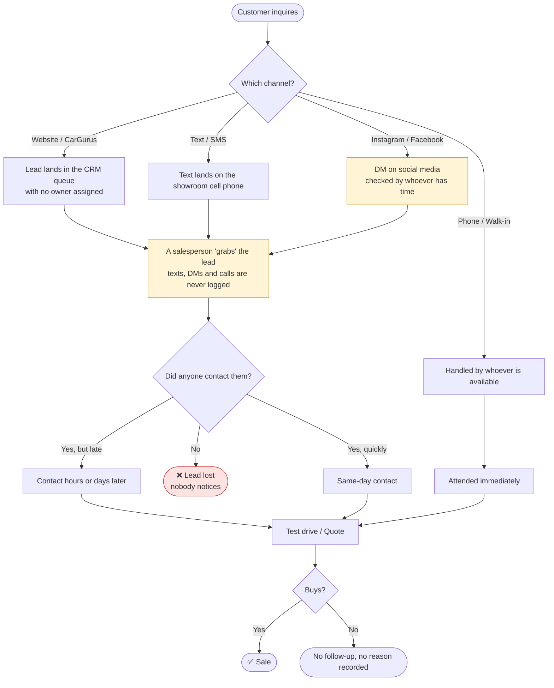

# 1 · Diagnosis: how the Lead → Sale process works today

> **Company:** Redwood Auto Group (fictional) · multi-brand dealership in Dallas–Fort Worth, Texas · 6 salespeople · ~500 leads per month.
> **Period analyzed:** January to June 2026 · 3,021 leads.
> **Business question:** *"We get lots of interested customers, but we sell very few cars. Where are we losing them?"*

## 1.1 How the information was gathered

| Source | What was done |
|---|---|
| Interviews (30 min each) | Sales manager, 3 salespeople and the receptionist |
| Observation | A full day on the showroom floor, following how leads arrive and get distributed |
| Data | Export of the period's leads: channel, salesperson, dates, stage reached |

## 1.2 Current process (AS-IS)

**What was observed:** there is no single point of entry. Website and CarGurus leads reach the CRM, but sit in a shared queue with no owner. Texts, social media DMs and phone calls usually never make it into the CRM at all. Assignment depends on who happens to be looking at the phone or the queue. Nobody measures how long the first contact takes, and lost leads are never recorded anywhere.

## 1.3 Findings (with evidence)

| # | Finding | Evidence in the data |
|---|---|---|
| **F1** | **1 in 4 leads never gets a reply** | Only **75.6%** were contacted: **~123 leads per month** are lost without contact |
| **F2** | **Response is slow** | Median time to first contact is **17.7 hours**, and **40%** of contacts happen after 24 h |
| **F3** | **Slowness costs sales** | Contacted within 1 h, a lead converts at **10.7%**; after 24 h, only **4.9%** (**2.2× less**) |
| **F4** | **Social media has no owner** | Instagram: **58%** contacted, 3.9% conversion. Facebook: 66% and 4.4% |
| **F5** | **Workload is unevenly spread** | 2 salespeople take **45%** of leads ("first come, first served"). Three salespeople contact fewer than 70% of the leads they take |
| **F6** | **No data to manage with** | Nobody records why a sale is lost, and the sales manager has no daily visibility |

> 📊 All these figures can be explored in the [dashboard](4-measurement/dashboard.html).

## 1.4 Root cause

Asking *"why?"* repeatedly, starting from the main problem:

1. **Why are leads lost?** → Because nobody notices when a lead hasn't been attended.
2. **Why does nobody notice?** → Because leads arrive in 5 different places and aren't recorded.
3. **Why aren't they recorded?** → Because there's no owner and no single entry tool.
4. **Why isn't there one?** → Because the process grew organically as channels were added (social media, CarGurus) without being redesigned.

**Root cause:** the problem isn't the people. **The process has no single point of entry, no clear assignment, and no alert when something falls behind.**

## 1.5 What the problem costs

| Metric (monthly average) | Value |
|---|---|
| Leads received | 504 |
| Leads never contacted | 123 |
| Lead → sale conversion | 6.8% |
| Sales | 34.2 |
| Average gross profit per vehicle sold (incl. F&I) | ~$2,800 |

If the 123 uncontacted leads converted at just 4.9% (the worst band's rate), that would be **~6 more sales per month, about $17K in gross profit per month** lost **simply by not replying**. On top of that comes what could be gained by replying faster to the leads that do get contacted.

➡️ Next: [2 · Proposal](2-proposal.md)
