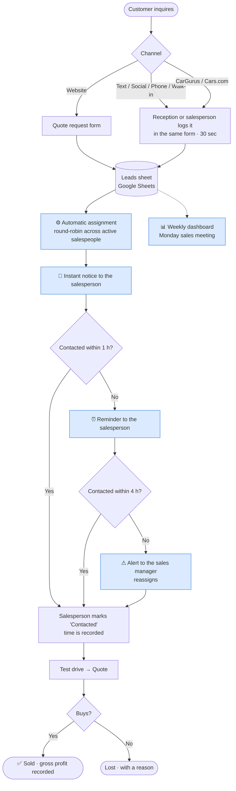

# 2 · Proposal: a redesigned Lead → Sale workflow

## 2.1 Design principles

1. **One front door:** every lead, wherever it comes from, is recorded in the same place.
2. **An owner from minute one:** assignment is automatic and even, not dependent on who's looking at the phone.
3. **The system reminds, not people's memory:** if a lead falls behind, an alert goes out.
4. **Measure to manage:** every stage change is recorded and feeds a dashboard.
5. **Prove it before buying anything:** prototype the workflow with Google Sheets and Gmail. Once it works, the same rules (round-robin, response-time alerts) get configured in the dealership's CRM.

## 2.2 Proposed process (TO-BE)

*In blue: automated steps.*

## 2.3 What changes and why

| Finding | Proposed change | Tool | Owner |
|---|---|---|---|
| F1 · Leads with no reply | Single log for every lead + visible status ("New") | [Form](3-implementation/form.html) + Sheets | Reception / salesperson |
| F2 · Slow response | Contact target of < 1 h, with instant notice and automatic reminder | [Apps Script](3-implementation/apps-script.gs) | Assigned salesperson |
| F3 · Slowness costs sales | Escalation to the manager at 4 h, with reassignment | Apps Script (every 15 min) | Sales manager |
| F4 · Social media has no owner | Social leads go through the same log; reception checks them 3 times a day | Form | Reception |
| F5 · Uneven workload | Round-robin assignment across active salespeople (can be paused for vacations) | Apps Script | Automatic |
| F6 · No data | Funnel by status (New → Contacted → Test drive → Quote → Sold/Lost) | Sheets + [Dashboard](4-measurement/dashboard.html) | Sales manager |

## 2.4 Service levels (SLA)

| Event | Deadline | What happens if it's missed |
|---|---|---|
| First contact | **< 1 business hour** | Email reminder to the salesperson |
| First contact | **< 4 business hours** | Alert to the sales manager, who reassigns |
| Status update | Same day | Shows up on the dashboard as "not updated" |

## 2.5 KPIs to track

| KPI | Baseline (current) | Pilot target |
|---|---|---|
| % of leads contacted | 75.6% | ≥ 90% |
| Median time to first contact | 17.7 h | ≤ 1 h |
| % of contacts after 24 h | 40% | ≤ 10% |
| Lead → sale conversion | 6.8% | ≥ 9% |

## 2.6 Implementation plan (3-month pilot)

| Week | Activity |
|---|---|
| 1 | Set up the sheet, form and script. Load the salespeople. Test with dummy leads |
| 2 | 45-min team training: how to log leads and change statuses. Pilot starts |
| 3–4 | Daily support: review alerts and fix friction points |
| Months 2–3 | Weekly meeting around the dashboard. Adjust SLAs and assignment based on what's observed |
| End of month 3 | Evaluation: compare KPIs against the baseline and decide whether to scale |

## 2.7 Risks and mitigation

| Risk | Mitigation |
|---|---|
| Salespeople don't update statuses | One click (dropdown). The manager reviews the "not updated" ranking every Monday |
| Logging text-message leads feels like a chore | 30-second, mobile-friendly form. Phase 2: connect a business texting platform so texts are logged automatically |
| A salesperson with many open leads keeps receiving more | "Active" column to pause them. Phase 2: workload-weighted assignment |
| Personal data in the sheet | Access restricted to the sales team. The dashboard only receives columns without personal data |

⬅️ [1 · Diagnosis](1-diagnosis.md) · ➡️ [3 · Implementation](3-implementation/README.md)
