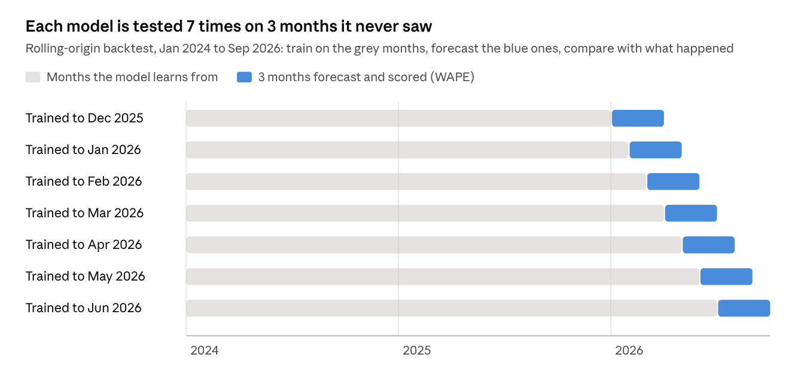

# Demand Forecast Model: Project Book

**Diego Silva** · October 2026 · Download: [PDF](project-book.pdf) · [Word](project-book.docx)

## Summary

A demand forecast by vehicle segment cuts forecast error from 11.9% to 7.2% against the dealership's current ordering rule, and an order plan built on it saves about $38K a quarter (about $150K a year).

The model predicts how many customers will ask about each type of vehicle (sedans, compact SUVs, midsize SUVs, pickups, hybrids/EVs) over the next three months. It tests four approaches on months it never saw, keeps the most accurate one for each segment, and gives a likely range rather than a single number. The forecast is then turned into recommended orders that keep every segment at 45–60 days of supply.

The headline finding for Oct–Dec 2026: hybrid demand runs 37% above what the current rule plans for, while sedan demand runs 6% below it. Ordering from the forecast avoids about 25 lost sales and brings sedan stock from 108 days down to 54.

This book explains the project context, the data, how each model works, how accuracy was measured, the results and their limits. All data is synthetic; the company is fictional.

## Project context

This forecast is Case 02 of a portfolio that shows how process analysis and data work improve a car dealership's results. The portfolio is public on [GitHub](https://github.com/diegosilva-design/car-dealership-data-portfolio) with live demo pages.

**The company.** Redwood Auto Group is a fictional multi-brand dealership in Dallas–Fort Worth, Texas, with 6 salespeople and about 500 customer inquiries (leads) a month. Every number in the project comes from synthetic data built to behave like a real store.

**Case 01 · Lead → Sale.** The first case fixed how the store handles leads. A quarter of inquiries never got a reply, and first contact took 17.7 hours on average. A new workflow (one entry point, automatic assignment, response-time alerts) was piloted from July 2026 and raised lead-to-sale conversion from 6.8% to 10.7%.

**Why Case 02 exists.** Selling more exposed a second problem: the lot did not have the right cars. Stock was ordered from last year's sales plus 5%, so the store had about 150 days of sedans (healthy is 45–60) while hybrids sold out and had to be borrowed from sister stores. Case 02 asks what customers will want next, and how much of each type to order.

| Case | Question | Main deliverables |
| --- | --- | --- |
| [01 · Lead → Sale](../01-lead-to-sale/README.md) | Why do so many interested customers turn into so few sales? | Process diagnosis, new workflow, quote form, Google Sheets automation, monthly KPI dashboard |
| [02 · Demand forecast](README.md) | Is the store ordering the right cars for what customers want next? | Demand & Mix analysis, forecast notebook, Forecast page, Inventory plan page |

## The business question

The question the model answers: how many customers will ask about each vehicle segment in each of the next three months, and how sure can we be?

Three months matches how a dealership plans stock. Factory orders and allocations are placed one to three months ahead, so a forecast further out would change nothing, and a shorter one would come too late.

**Why we forecast leads, not sales.** A lead is a customer asking about a specific vehicle, so leads measure demand directly. Sales also depend on things the store controls: whether the car is on the lot and how well the sales team follows up. In July 2026 the new lead workflow raised conversion in every segment. A model trained on sales would read that jump as customers suddenly wanting more cars, which is wrong.

So the work splits in two:

1. **Forecast leads** by segment: pure demand, unaffected by the sales process.
2. **Convert leads into expected sales** with the current conversion rate (10.7%, the store-wide rate during the pilot).

If the sales process changes again, only step 2 needs updating.

## The data

The model learns from 33 months of leads (Jan 2024 – Sep 2026, 15,466 inquiries), counted by month and segment. That gives 33 data points per segment: enough to see one yearly pattern repeat, but short by forecasting standards.

Each lead records when it arrived, the channel, the vehicle asked about (with its segment and price), the customer's city and whether it became a sale. Separate files hold monthly inventory by segment (stock, cars received, cars borrowed from sister stores, cars sold) and 2026 targets.

| Segment | Models | Typical price (USD) | Share of leads, 2024 | Share of leads, last 12 months |
| --- | --- | --- | --- | --- |
| Sedan / compact | Corolla, Civic, Elantra, Trax | $22K–$26K | 34% | 27% |
| Compact SUV | RAV4, CR-V, Equinox, Tucson, Sportage, Rogue | $29K–$32K | 34% | 35% |
| Midsize SUV | Explorer, Grand Cherokee | $39K–$42K | 10% | 10% |
| Pickup | F-150, Tacoma | $34K–$41K | 17% | 17% |
| Hybrid / EV | RAV4 Hybrid, Camry Hybrid, Ioniq 5 | $30K–$43K | 5% | 11% |

**Patterns built into the data on purpose**, so the analysis has something real to find:

- **Mix shift:** demand moves from sedans to SUVs, pickups and above all hybrids/EVs.
- **Seasonality:** a spring peak (tax refunds, March busiest), a quiet October and a year-end peak in December; pickups peak in December, hybrids in early summer.
- **Affordability:** higher interest rates in 2024–2025 lowered closing rates on vehicles over $35K.
- **Local taste:** pickups are strong in Fort Worth and Denton, hybrids and compact SUVs in Plano and Frisco.
- **Lagging inventory:** stock was ordered from last year's sales, so it trails every trend.

The data is generated by a [script](../data/generate_data.ps1) with a fixed seed, so every run produces the same files.

## How the four models work

Four models were built, from the simplest possible to a standard statistical method. Each one turns the history of a segment into a number for each of the next three months. In the formulas, y is monthly leads, t is the current month and h is how many months ahead (1, 2 or 3).

### 1. Current rule: same month last year + 5%

This is what the dealership does today, so it is the bar every other model must beat. It assumes every segment grows 5% a year, whatever is really happening.

```math
\hat{y}_{t+h} = 1.05 \times y_{t+h-12}
```

### 2. Last year × growth

The same idea, but the growth rate is measured instead of assumed: the last 12 months compared with the 12 before. A segment growing 49% a year gets a 49% uplift; a shrinking one gets a cut.

```math
\hat{y}_{t+h} = y_{t+h-12} \times \frac{\sum_{i=0}^{11} y_{t-i}}{\sum_{i=12}^{23} y_{t-i}}
```

### 3. Holt-Winters (exponential smoothing)

Holt-Winters keeps three running estimates and updates them every month: the **level** (where demand is now), the **trend** (how fast it is moving) and the **seasonal effect** of each calendar month. Each update blends the newest month with the previous estimate, so recent months count more than old ones. The trend is **damped**: it fades over the forecast horizon so a recent surge is not extended forever.

```math
\begin{aligned}
\ell_t &= \alpha\,(y_t - s_{t-12}) + (1-\alpha)(\ell_{t-1} + \phi\, b_{t-1}) \\
b_t &= \beta\,(\ell_t - \ell_{t-1}) + (1-\beta)\,\phi\, b_{t-1} \\
s_t &= \gamma\,(y_t - \ell_t) + (1-\gamma)\, s_{t-12} \\
\hat{y}_{t+h} &= \ell_t + (\phi + \phi^2 + \dots + \phi^h)\, b_t + s_{t+h-12}
\end{aligned}
```

The weights α, β, γ (how fast each estimate reacts) and the damping φ are not chosen by hand: the software (Python's statsmodels) picks the values that would have fitted the history best. It needs two full years of data to learn the seasonal pattern.

### 4. Regression with trend and seasonal waves

This model draws one smooth curve through the history: a straight trend plus two yearly waves (sine and cosine curves, also called Fourier terms) that capture the seasonal ups and downs. It works on the logarithm of leads, so growth is treated as a percentage rather than a fixed number of leads. With only 6 numbers to estimate, it is hard to overfit.

```math
\log(y_t + 1) = a + b\,t + \sum_{k=1}^{2} \left[ c_k \sin\left(\frac{2\pi k t}{12}\right) + d_k \cos\left(\frac{2\pi k t}{12}\right) \right]
```

The coefficients a, b, c and d are fitted by ordinary least squares, and the curve is extended three months ahead.

| Model | Learns the trend? | Learns seasonality? | Reacts to recent changes? | Complexity |
| --- | --- | --- | --- | --- |
| Current rule | No (fixed +5%) | Copies last year | No | None |
| Last year × growth | Yes, one rate a year | Copies last year | Slowly | Very low |
| Holt-Winters | Yes, updated monthly | Yes, learned | Yes | Medium |
| Regression | Yes, one straight trend | Yes, smooth waves | No | Low |

## How accuracy was tested

The best model across all segments, Holt-Winters, was off by 7.0% on months it had never seen, against 9.6% for the current rule: 27% less error.

A model can fit the past perfectly and still forecast badly, so accuracy is only measured on months the model did not see. The method is a **rolling-origin backtest**:

1. Pretend it is the end of December 2025. Train each model on everything up to then.
2. Forecast January, February and March 2026, and compare with what actually happened.
3. Move forward one month (end of January 2026), retrain, forecast the next three months, compare.
4. Repeat up to the end of June 2026, the last start point with three known months after it.



Each run learns from one more month than the last, so every forecast is made only with information that existed at the time.

That gives 7 start points × 3 months × 5 segments = 105 test forecasts per model. Testing starts in December 2025 because Holt-Winters needs two full years of history to learn the seasonal pattern; every model is tested on the same start points so the comparison is fair.

**The error measure is WAPE** (weighted absolute percentage error): the total size of the misses divided by the total actual leads.

```math
\text{WAPE} = \frac{\sum |\,\text{actual} - \text{forecast}\,|}{\sum \text{actual}}
```

A WAPE of 8% means the forecast was off by 8 leads for every 100 that arrived. Unlike the average percentage error, WAPE is not thrown off by small months, where missing by 3 leads out of 10 would read as a 30% error.

| Model | WAPE, all segments |
| --- | --- |
| Holt-Winters | **7.0%** |
| Last year × growth | 8.3% |
| Regression | 8.4% |
| Current rule (LY +5%) | 9.6% |

## Choosing a model per segment and the likely range

Each segment uses the model that was most accurate for it in the backtest, which lowers the average error from 11.9% (current rule) to 7.2%.

No single model wins everywhere. Holt-Winters is best overall and essential for hybrids, where demand is growing fast. But the steadier segments are forecast better by simpler models, and for Midsize SUV the current rule itself is the most accurate. Using a complex model where a simple one does as well adds risk and nothing else, so each segment keeps its own **champion**.

**The likely range** comes from the backtest, not from a textbook formula. For each segment, we take the champion's test errors and find the 10th and 90th percentile: the miss it rarely exceeds in either direction. Those percentages are applied to the new forecast. Roughly 8 times out of 10, the real number should land inside the range. Because it is built from the model's own record, the range is honest about how good the model really is.

| Segment | Champion model | WAPE, champion | WAPE, current rule | Likely range around the forecast |
| --- | --- | --- | --- | --- |
| Hybrid / EV | Holt-Winters | 11.3% | 28.9% | −14% to +18% |
| Sedan / compact | Regression | 7.3% | 10.5% | −10% to +14% |
| Pickup | Regression | 5.4% | 7.0% | −10% to +4% |
| Compact SUV | Last year × growth | 3.1% | 3.8% | −9% to +4% |
| Midsize SUV | Current rule (LY +5%) | 9.2% | 9.2% | −15% to +13% |

The champions are then retrained on all 33 months to produce the final forecast.

## Forecast for Oct – Dec 2026

Hybrid/EV demand is forecast at 186 leads for the quarter, 37% above the 136 the current rule plans for; sedans come in 6% below the rule.

The gap is largest exactly where demand is changing fastest. The current rule copies last year and adds 5%, so it cannot see a segment that grew 49% in a year. Where demand is stable (Midsize SUV, Compact SUV) the forecast and the rule nearly agree, which is a useful sanity check: the model only departs from the rule where the data gives it a reason.

Leads convert into expected sales at the store-wide pilot rate of 10.7%. Per-segment rates were tested but rejected: three months of pilot data are too few (one segment showed 18% on just 25 sales), so one rate for all is the more reliable choice.

| Segment | Leads forecast (quarter) | Current rule | Difference | Expected sales |
| --- | --- | --- | --- | --- |
| Hybrid / EV | 186 | 136 | **+37%** | 17–23 |
| Pickup | 287 | 271 | +6% | 27–32 |
| Compact SUV | 522 | 505 | +3% | 51–58 |
| Midsize SUV | 174 | 174 | 0% | 16–21 |
| Sedan / compact | 363 | 386 | **−6%** | 35–44 |

Month by month, the forecast follows the seasonal pattern: October dips (the quietest month of the year), and December rises with year-end deals and pickup promotions.

## From forecast to orders

Ordering from the forecast costs about $113K for the quarter against about $151K under the current rule: roughly $38K saved per quarter, $150K a year.

A forecast only creates value if it changes what gets ordered. Both ordering approaches were run month by month against the same expected sales, starting from the stock on the lot at the end of September 2026.

- **Current rule:** order last year's average sales for the same three months, plus 5% (sedans +20% from factory allocations, hybrids capped at 4 a month by supply).
- **Forecast plan:** order enough to end each month with **50 days of expected sales**, inside the healthy 45–60 day range, plus a **safety buffer** equal to the gap between the high end of the forecast range and the forecast itself.

In plain terms, each month the plan works out:

```math
\text{order} = \max\Big(0,\ \underbrace{\tfrac{50}{30} \times \text{avg. monthly sales}}_{\text{target stock}} + \underbrace{(\text{high} - \text{forecast})}_{\text{safety buffer}} + \text{expected sales} - \text{stock at start}\Big)
```

**When the lot runs short**, half of those customers are served with a car borrowed from a sister store (a transfer) and half buy elsewhere (a lost sale). Every cost is stated so it can be challenged:

| Cost item | Assumption |
| --- | --- |
| Holding a car on the lot | $400 per car per month (floorplan interest + depreciation on a ~$30K vehicle) |
| Borrowing from a sister store | $400 per car (driver, fuel, paperwork) |
| Lost sale | $2,978, the average gross profit per car sold in 2026 (vehicle + finance and insurance) |
| Share of short customers who buy elsewhere | 50% |

| Result, Oct – Dec 2026 | Current rule | Forecast plan |
| --- | --- | --- |
| Cars ordered | 109 | 201 |
| Customers who find no car | 50 (25 borrowed, 25 lost) | 0 |
| Segments ending in the healthy range | 0 of 5 | 5 of 5 |
| Sedan supply at the end of December | 108 days | 54 days |
| Quarter cost (holding + transfers + lost gross profit) | ~$151K | ~$113K |

**How robust is the conclusion?** The current rule looks cheaper on holding cost alone, because a near-empty lot costs little to keep. It loses once lost sales are counted. The break-even point is about **21%**: if more than about 1 in 5 customers who find no car would buy elsewhere, the forecast plan is cheaper. The [Inventory plan page](https://diegosilva-design.github.io/car-dealership-data-portfolio/01-lead-to-sale/4-measurement/plan.html) has sliders to test this and the holding cost.

An honest note: the first version of this comparison assumed every missing car could be borrowed, which made the current rule look cheaper. Counting lost sales reversed the result, and the break-even shows how much that assumption matters.

## Limitations and next steps

The method is sound for a pilot; the main risk is the short history, which is why the backtest should be re-run every month.

| Limitation | Why it matters | What to do next |
| --- | --- | --- |
| Short history (33 months, 7 test start points) | One yearly pattern seen, tested only a few times; accuracy figures could move | Re-run the backtest monthly and track the error over time |
| Synthetic data | Trends were built in on purpose, so the models had something clean to find | Apply the same notebook to the dealership's real CRM export |
| One conversion rate for all segments | Some segments really do convert differently | Switch to segment rates once 6–12 months of pilot data exist |
| No outside drivers | Interest rates, gas prices and model launches move demand | Add them as inputs to the regression model |
| Simplified inventory flow | Orders assumed to arrive within the month; sales timed by lead month | Add real lead times per brand and order cut-off dates |
| Round-number costs | Holding, transfer and lost-sale costs vary by store | Replace with the store's floorplan rate and real transfer costs |

The natural next step is to run the plan as a live trial: order one segment (hybrids, where the gap is largest) from the forecast for a quarter, and compare stock-outs, transfers and days on lot with the other segments.

## Glossary and files

| Term | Meaning |
| --- | --- |
| Lead | A customer inquiry about a specific vehicle (website, text, phone, social media, CarGurus, walk-in) |
| Segment | A group of similar vehicles: Sedan / compact, Compact SUV, Midsize SUV, Pickup, Hybrid / EV |
| Conversion | Share of leads that end in a sale |
| Seasonality | The pattern that repeats every year (busy March and December, quiet October) |
| Trend | The long-term direction of demand, up or down |
| Backtest | Testing a model on past months it was not allowed to see |
| WAPE | Weighted absolute percentage error: total misses ÷ total actual leads |
| Champion | The most accurate model for a segment in the backtest |
| Likely range | The 10th–90th percentile band from the champion's past errors; the real number lands inside about 8 times in 10 |
| Days of supply | Cars in stock ÷ average daily sales; 45–60 days is healthy |
| Transfer | A car borrowed from a sister store to serve a customer |
| Gross profit | Profit on a car sold, including finance and insurance products |

| File | What it contains |
| --- | --- |
| [demand_forecast.ipynb](demand_forecast.ipynb) | The full analysis in Python: data, models, backtest, forecast, inventory plan |
| [Case 02 README](README.md) | One-page executive summary of the case |
| [Forecast page](https://diegosilva-design.github.io/car-dealership-data-portfolio/01-lead-to-sale/4-measurement/forecast.html) | Interactive forecast by segment and model accuracy |
| [Inventory plan page](https://diegosilva-design.github.io/car-dealership-data-portfolio/01-lead-to-sale/4-measurement/plan.html) | Recommended orders, cost comparison and what-if sliders |
| [Demand & Mix page](https://diegosilva-design.github.io/car-dealership-data-portfolio/01-lead-to-sale/4-measurement/demand.html) | Segment trends, seasonality, affordability, demand by area, inventory health |
| [data/](../data/) | leads.csv, inventory.csv, forecast.csv, inventory_plan.csv: the data behind every number |
