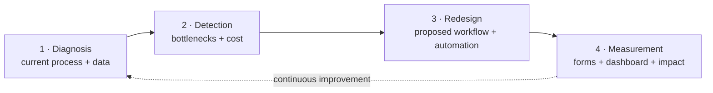

# Process & data analysis for car dealerships

**I find where your processes lose time and money, propose a better workflow, implement it with simple tools, and prove the impact with data.**

👤 **Diego Silva** · [Email](mailto:diegosilvamancilla@gmail.com)

---

## Cases

| # | Case | Business question | Result | Status |
|---|---|---|---|---|
| 01 | [**Lead → Sale**](01-lead-to-sale/README.md) | Why do so many interested customers turn into so few sales? | Conversion 6.8% → 10.7% · ~$29K/month in additional gross profit (base scenario) | ✅ Complete |
| 02 | [**Demand forecast**](02-demand-forecast/README.md) | Is the dealership ordering the right cars for what customers want next? | Forecast error 11.9% → 7.2% vs the current ordering rule · hybrid demand +37% above plan | ✅ Complete |
| 03 | Service shop / After-sales | How long does each service take, and how satisfied are customers? | — | 🔜 Coming soon |
| 04 | Used-car trade-in appraisal | How do we appraise faster, with consistent criteria? | — | 🔜 Coming soon |

## How I work



Method details and an express-diagnosis questionnaire: [docs/methodology.md](docs/methodology.md)

## Live demos

- 📝 [Quote request form](https://diegosilva-design.github.io/car-dealership-data-portfolio/01-lead-to-sale/3-implementation/form.html)
- 📊 [Lead → Sale dashboard](https://diegosilva-design.github.io/car-dealership-data-portfolio/01-lead-to-sale/4-measurement/dashboard.html)
- 📈 [Demand & Mix: trends, seasonality and inventory health](https://diegosilva-design.github.io/car-dealership-data-portfolio/01-lead-to-sale/4-measurement/demand.html)
- 🔮 [Demand forecast: next quarter by segment](https://diegosilva-design.github.io/car-dealership-data-portfolio/01-lead-to-sale/4-measurement/forecast.html)
- 📓 [Forecast notebook (Python)](02-demand-forecast/demand_forecast.ipynb)

> The demos run live on GitHub Pages with synthetic data; the form runs in demo mode.

## Tools

`Process analysis (AS-IS / TO-BE, 5 whys)` · `Mermaid` · `Google Sheets` · `Google Apps Script` · `HTML / JavaScript` · `Chart.js` · `Python (pandas, statsmodels)` · `Forecasting & backtesting` · `PowerShell`

## Structure

```
├── data/                     synthetic leads (2024–2026), 2026 targets, inventory + the script that generates them
├── docs/methodology.md       how I work
├── 01-lead-to-sale/
│   ├── README.md             executive summary
│   ├── 1-diagnosis.md        AS-IS, findings, root cause
│   ├── 2-proposal.md         TO-BE, SLAs, KPIs, plan, risks
│   ├── 3-implementation/     form + Apps Script
│   ├── 4-measurement/        report pages: Lead → Sale, Demand & Mix, Forecast
│   └── 5-impact.md           results and economic value
└── 02-demand-forecast/
    ├── README.md             executive summary
    └── demand_forecast.ipynb trends, 4 models, backtest, Oct–Dec 2026 forecast
```

> **Note:** "Redwood Auto Group" is a fictional company and all data is synthetic. Regenerate it with `powershell -ExecutionPolicy Bypass -File data\generate_data.ps1`.
