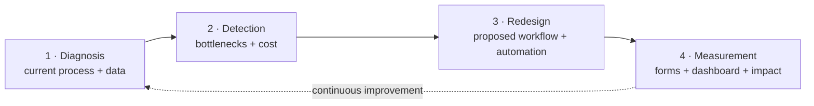

# Process & data analysis for car dealerships

**I find where your processes lose time and money, propose a better workflow, implement it with simple tools, and prove the impact with data.**

<!-- TODO: add your name, a one-line bio and your links -->
👤 **[Your name]** · [LinkedIn](https://www.linkedin.com/in/your-profile) · [Email](mailto:you@example.com)

---

## Cases

| # | Case | Business question | Result | Status |
|---|---|---|---|---|
| 01 | [**Lead → Sale**](01-lead-to-sale/README.md) | Why do so many interested customers turn into so few sales? | Conversion 6.8% → 10.7% · ~$27K/month in additional gross profit (base scenario) | ✅ Complete |
| 02 | Service shop / After-sales | How long does each service take, and how satisfied are customers? | — | 🔜 Coming soon |
| 03 | Used-car trade-in appraisal | How do we appraise faster, with consistent criteria? | — | 🔜 Coming soon |

## How I work



Method details and an express-diagnosis questionnaire: [docs/methodology.md](docs/methodology.md)

## Live demos

- 📝 [Quote request form](01-lead-to-sale/3-implementation/form.html)
- 📊 [Lead → Sale dashboard](01-lead-to-sale/4-measurement/dashboard.html)

> On GitHub Pages: `https://<your-username>.github.io/car-dealership-data-portfolio/`

## Tools

`Process analysis (AS-IS / TO-BE, 5 whys)` · `Mermaid` · `Google Sheets` · `Google Apps Script` · `HTML / JavaScript` · `Chart.js` · `PowerShell`

## Structure

```
├── data/                     synthetic data + the script that generates it
├── docs/methodology.md       how I work
└── 01-lead-to-sale/
    ├── README.md             executive summary
    ├── 1-diagnosis.md        AS-IS, findings, root cause
    ├── 2-proposal.md         TO-BE, SLAs, KPIs, plan, risks
    ├── 3-implementation/     form + Apps Script
    ├── 4-measurement/        dashboard
    └── 5-impact.md           results and economic value
```

> **Note:** "Redwood Auto Group" is a fictional company and all data is synthetic. Regenerate it with `powershell -ExecutionPolicy Bypass -File data\generate_data.ps1`.
